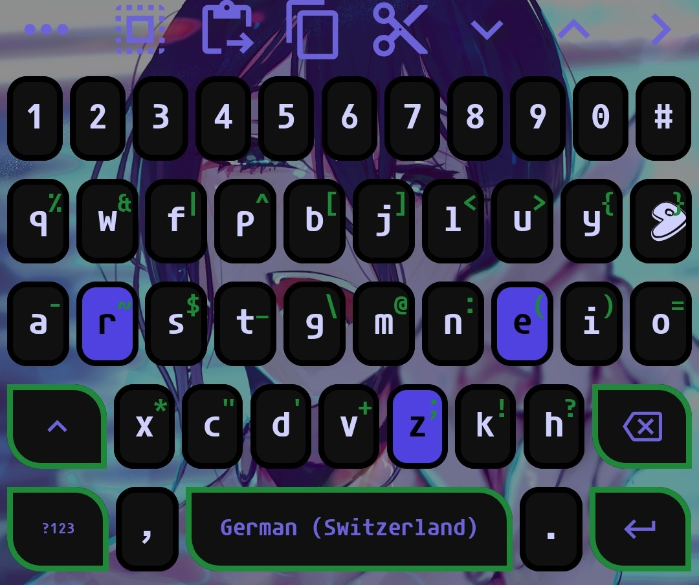
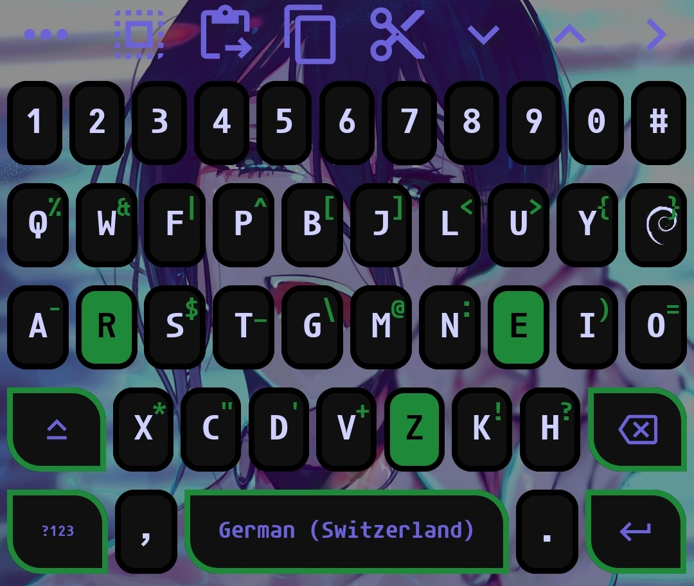
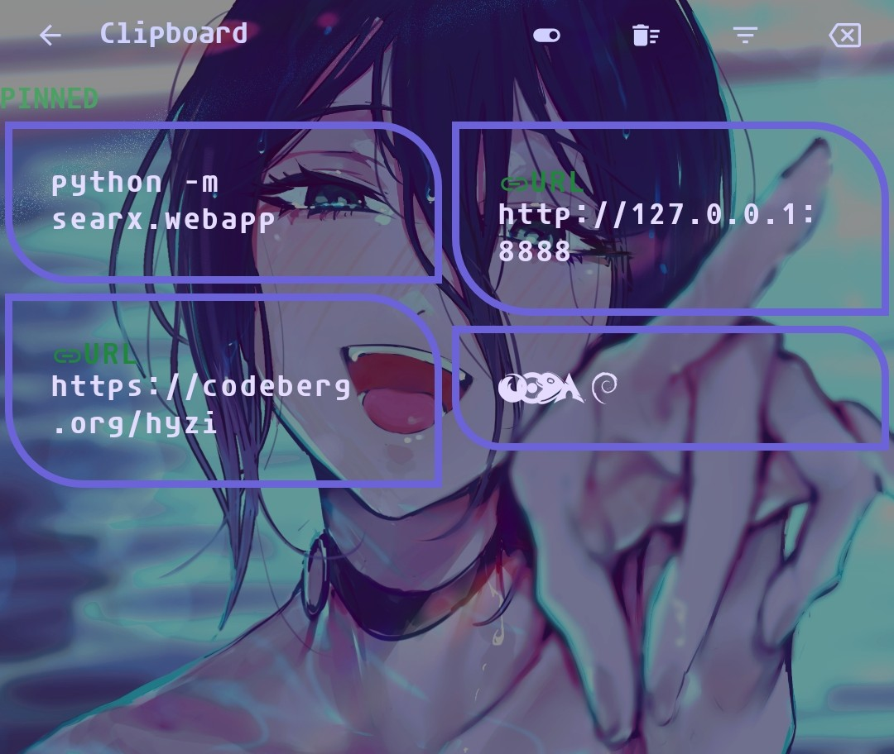
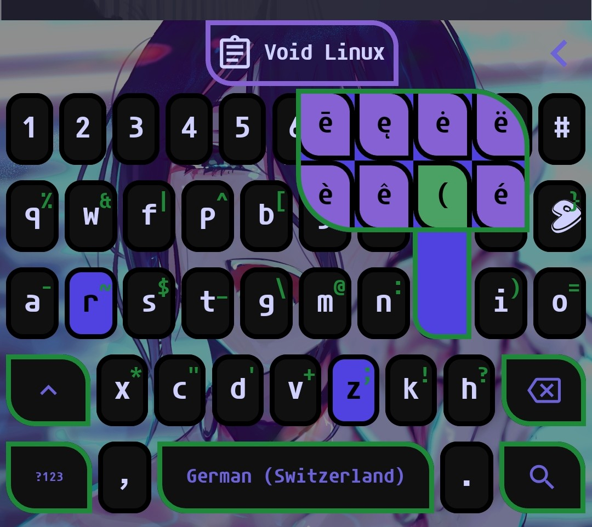

# Reze Theme for FlorisBoard

A clean, aesthetic theme inspired by Reze, designed for [FlorisBoard](https://github.com/florisboard/florisboard). All visual design was created independently.

## Screenshots

  

  

  

  

## About This Project
FlorisBoard has been my primary keyboard for the past year. My curiosity led me to explore its source code, theme engine, and settings. Once I realized the flexibility it offers for creating custom extensions, I decided to share my main theme, and layouts of characters and symbols.

## Layout Configuration
* **Main Layout:** I use **Colemak-DH** (built-in with FlorisBoard). The only modification was adding the `/` key and adjusting its visual appearance.
* **Symbols:** For coding comfort, I started with the default *Western (Additional symbols)* layout and adapted it to fit my workflow.

*(Note: Additional packages included in this extension are reserved for future use and are not currently active.)*

## Compatibility & Downloads
This theme was developed and tested on **FlorisBoard v0.6.0 ALPHA-0.2**.

Downloads:
* **`rezeboard.flex`**: Main theme package.
* **`layouts.flex`**: Custom keyboard layout package.

## Credits & Resources
* **FlorisBoard:** [FlorisBoard](https://github.com/florisboard/florisboard)
* **Font:** [Agave Nerd Font v3.5.1](https://github.com/ryanoasis/nerd-fonts/releases/download/v3.5.1/Agave.zip)
* **Background Artwork:** Found online and redesigned using AI assistance (original source unknown).
* **Translation Note:** AI was used to assist with translating this README into English.

## Current Status
To be honest, the theme is still a work in progress. It was built strictly around my own FlorisBoard setup with minimal essentials. Creating a fully featured version for all use cases requires significant time, but improvements will be added gradually.

## Author
Created by **[hyzi]**.

## License
This project is licensed under the [MIT License](LICENSE).

If you use, adapt, or share anything from this project, please keep the original credits and link back to this repository.
